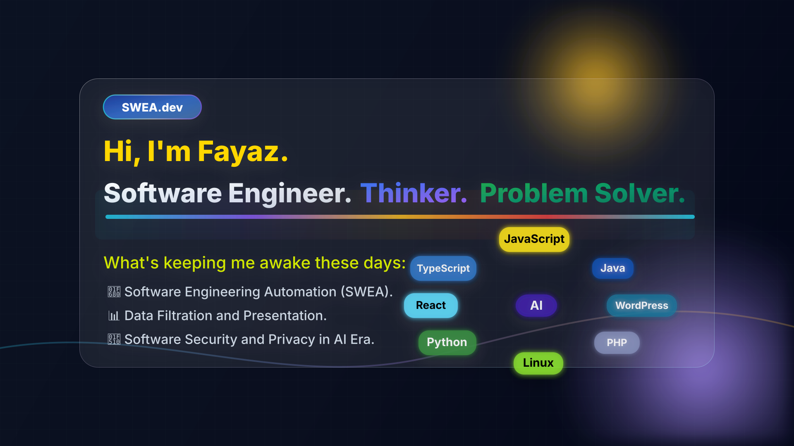

## 🛠️ I’m currently working on:

- [ ] 🔭 Experimenting with SWEA (Software Engineering Automation): Automating Software Engineering with AI in a way that empowers Software Engineers.

## ✅ Top Recent DEV.to Posts:

1. [Don't Stop Believing in Foundational Knowledge 🙏🏼](https://dev.to/fm/dont-stop-believing-in-foundational-knowledge-5e07).
2. [From a Simple "Mark as Seen" to Feedgrab & Ghostify](https://dev.to/fm/from-a-simple-mark-as-seen-to-feedgrab-ghostify-story-of-my-life-33dl).
3. [So, We Don't Need to Learn or Use Basic Math / Arithmetic Anymore?](https://dev.to/fm/we-dont-need-to-learn-basic-math-arithmetic-anymore-3e6b).
4. [Feeling Burnt Out? May Be You Should Read This!](https://dev.to/fm/feeling-burnt-out-may-be-you-should-read-this-2o8e).

## 🏆 Recent Wins:

✅ 🏆✨ Won the [Google Cloud NEXT '26 Writing Challenge](https://dev.to/devteam/congrats-to-the-google-cloud-next-26-writing-challenge-winners-5990) with my post [The 2026 Agentic Era with Gemini Agent Platform: Surviving Cascading Failures and Runaway Cloud Bills](https://dev.to/fm/the-2026-agentic-era-with-gemini-agent-platform-surviving-cascading-failures-and-runaway-cloud-1gbk).

✅ 🏆✨ Won the [Alibaba Cloud Game Development Hackathon on Dev.to](https://dev.to/devteam/congrats-to-the-alibaba-cloud-web-game-challenge-winners-2a3m) with my Game [Robonaut's Quest to Black Hole](https://dev.to/fm/robonauts-quest-on-alibaba-cloud-497l).

## 🎩 Skills/Languages

- **High Level Skills:** Software Architecture, Writing, Problem Solving.

- **Language Agnostic:** I've worked with so many things that at this point, I need just around two weeks to become good enough in any programming language or tool to work professionally, even without using AI.

## 📈 Learning list:

- Learning AI deeply (not only as a user).

## 🎓 Education:

Bachelor of Science (BSc) in [Computer Science & Engineering](https://en.wikipedia.org/wiki/Computer_science_and_engineering).

## ✍️ Older Writing Contributions:

- [Answered 150+ questions](https://stackexchange.com/users/456021/fayaz) on the StackExchange Network, mostly on WordPress.

- [75K+ answer views](https://www.quora.com/profile/Fayaz-Ahmed-10/) on Quora.

## 📫 Contact me:

- [Contact form at Fayaz.Dev](https://www.fayaz.dev/contact)
- [@sweadev on X](https://x.com/sweadev)
